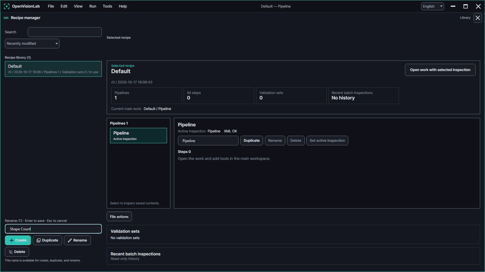
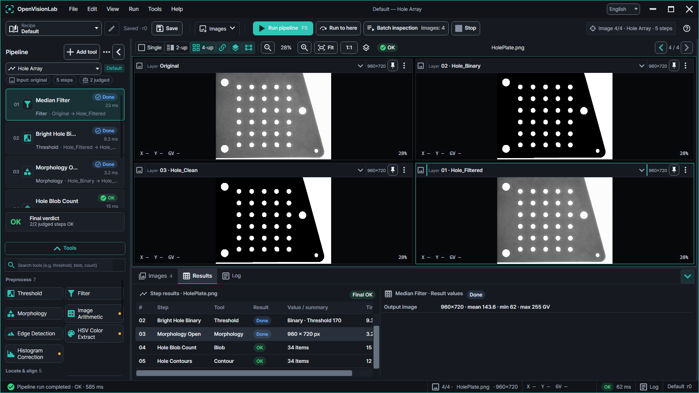
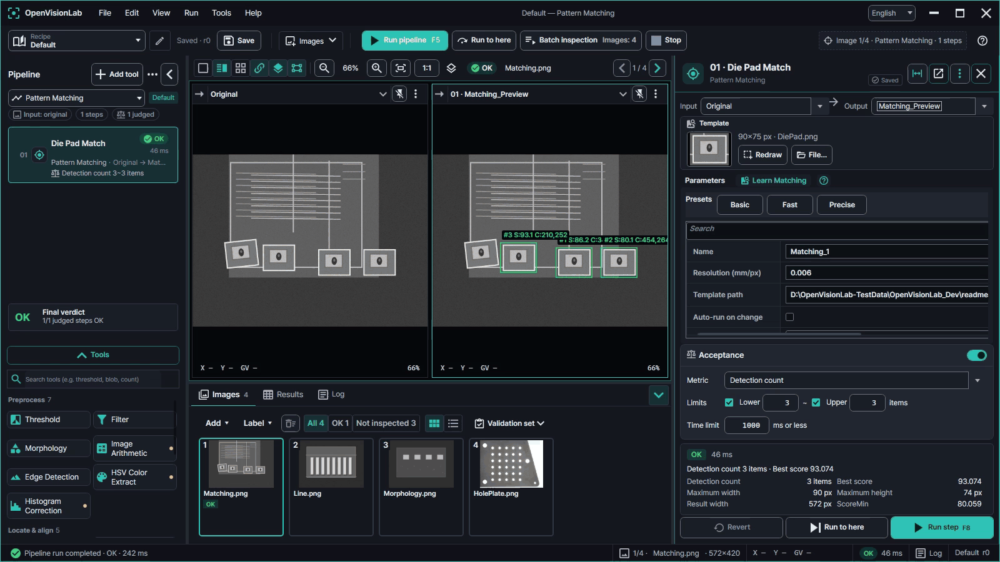
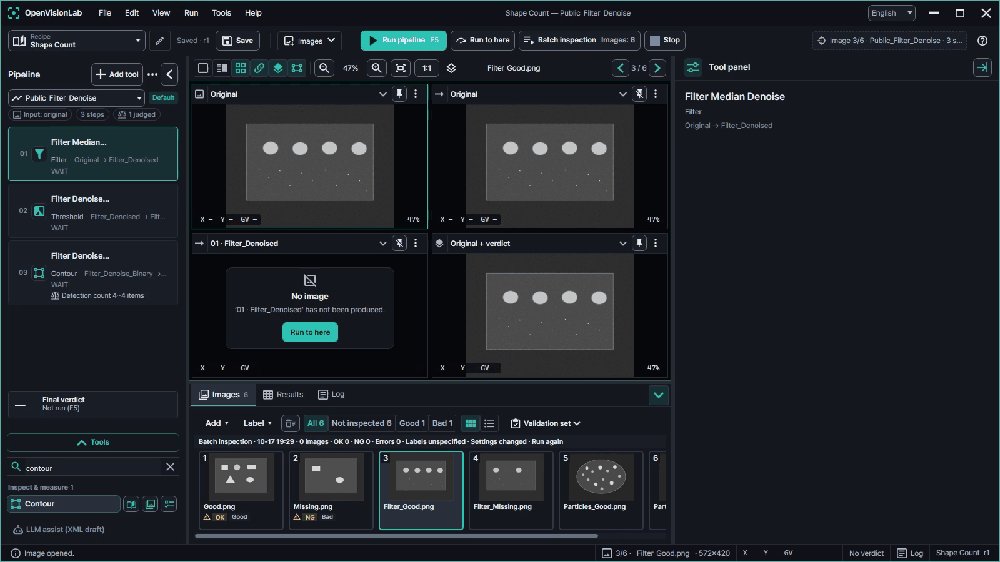
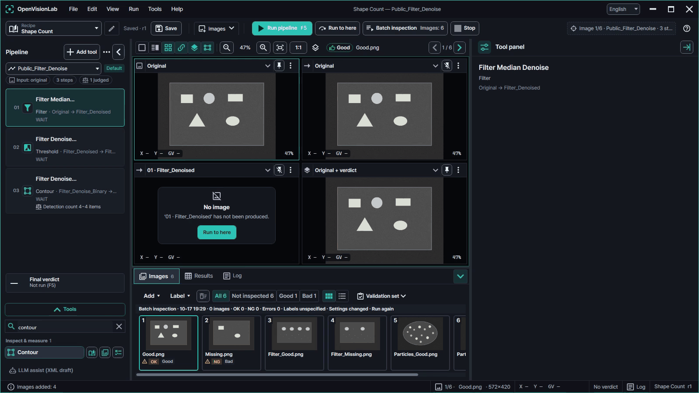
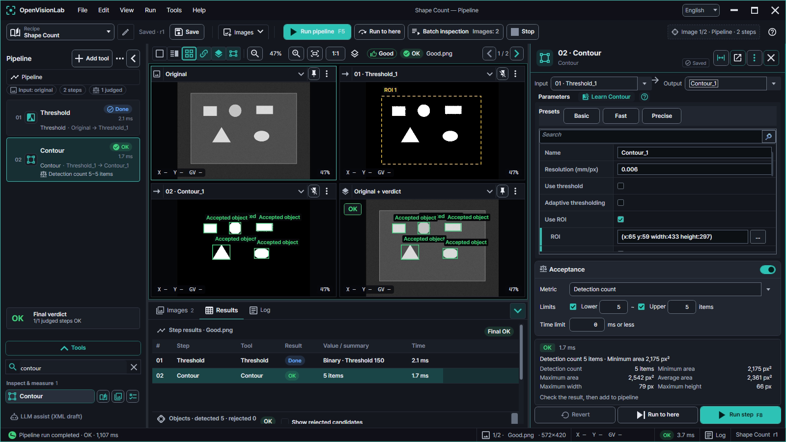
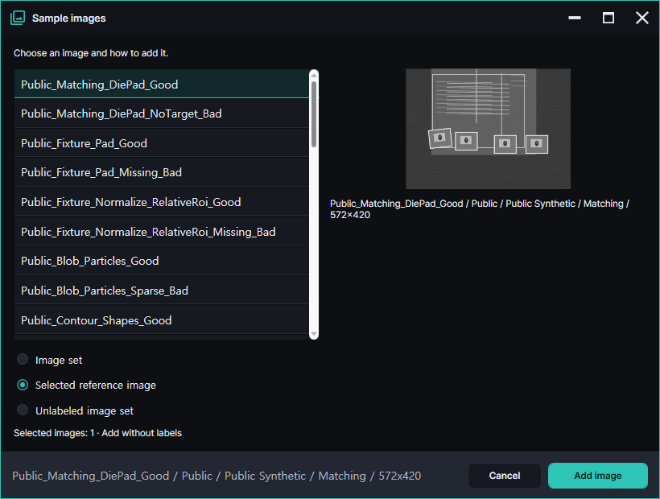
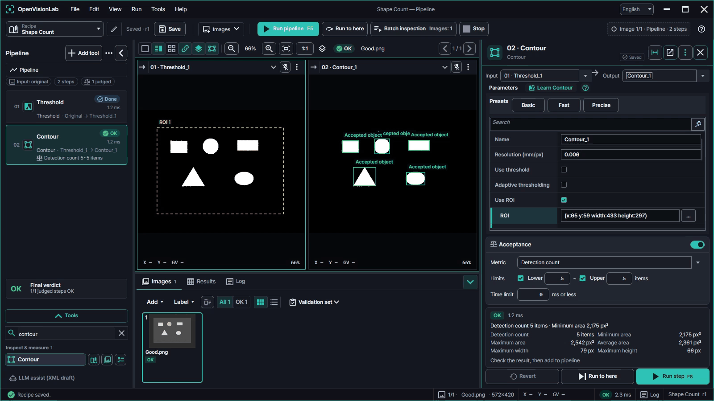
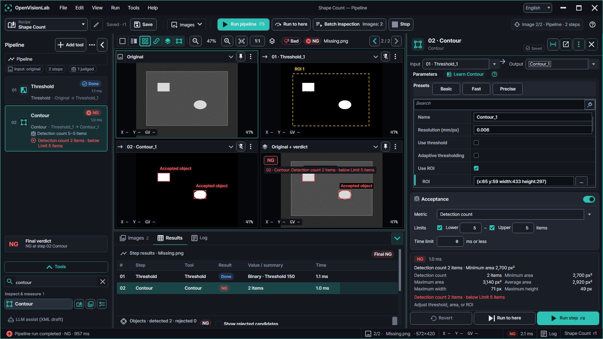

# OpenVisionLab

[한국어](README.ko.md)

OpenVisionLab is an **OpenCvSharp 4 rule-based machine vision workbench**.

Build inspection sequences, adjust tool parameters, and check the images and
measurements used for each OK/NG decision.

## Version

Current version: `v2.2.0-dev.11`

### Recent version history

#### `v2.2.0-dev.11` (2026-10-18)

- Adjusted Korean paragraph lengths and recipe instructions for narrower README views.

#### `v2.2.0-dev.10` (2026-10-18)

- Revised the English and Korean README instructions for inspection, setup and source builds.

#### `v2.2.0-dev.9` (2026-10-17)

- Matched the offline manual version to the application and fixed Guide checksum differences between Git checkouts.

#### `v2.2.0-dev.8` (2026-10-17)

- Reduced redundant updates during image selection, tool-editor activation and log filtering.
- Improved inline tool editing, recipe transitions and inspection-result review.
- Added a full Korean README and replaced the screenshots and workflow recordings.

#### `v2.2.0-dev.7` (2026-10-06)

- Updated selection and opening in Recipe Manager; edits are retained when
  opening is cancelled or saving fails.
- Updated shared controls and nine UI areas, including ROI dialog layout,
  long tool error messages, and input/output layer names.
- Fixed output-layer target synchronization and updated the main workspace,
  native tool forms, recipe persistence, pipeline execution and LLM/XML review.

#### `v2.2.0-dev.6` (2026-09-27)

- Included the recipe workspace sources and integration alpha.4 packages.
- Added NuGet lock files for repeatable dependency restores.
- Clarified the Visual Studio workload, desktop SDK and Git prerequisites for source builds.

#### `v2.2.0-dev.5` (2026-09-17)

- Added a 2D runtime check that blocks cross-repository smoke runs when the
  checkout commit or entry assembly bytes do not match the expected build.
- Added the profile, source and recipe identity, source dimensions, and
  screenshots to separate-EXE integration reports.

#### `v2.2.0-dev.4` (2026-09-16)

- Added 2D integration checks for retry, fault injection, input identity and
  output allocation.

#### `v2.2.0-dev.3` (2026-09-16)

- Updated Pipeline Review, recipe switching, multi-image validation, docking,
  tool interaction, workspace restoration, storage recovery, and execution
  source tracking.
- Added 2D integration checks and output-allocation checks before execution.
  LLM/XML assistance remains optional.

#### `v2.2.0-dev.2` (2026-09-10)

- Organized the Docking.Controls source by contracts, models, documents,
  workspace, guides, layer docking, converters, and Views.
- Preserved namespaces, XAML bindings, ResourceDictionary behavior, and the
  existing Image → Layer → Tool → Inspection → Pipeline → Recipe → Result → Review flow.

## Quick Overview

OpenVisionLab is a Windows desktop application for building and validating
rule-based inspection recipes from image samples.

- Workflow: load an image -> select a layer -> configure a tool -> run Preview
  or Run -> save the pipeline/recipe -> validate with Good and Bad samples
- Main tools: Threshold, Filter, Morphology, Blob, Contour, Matching,
  FeatureMatching, EdgeBasedMatching, Line/Length, and Mean
- Inspection setup: PropertyGrid tool settings, Pipeline Review, intermediate
  layer comparison, public samples, and multi-image validation
- LLM/XML assistance is optional and is not required to use the application

## Build and Check a Recipe



1. In **Recipe Manager**, create `Shape Count`, then choose
   **Open work with selected inspection** and open an image.
2. Open **Threshold**. Turn **Run on change** off, set the threshold to `150`,
   and choose **Run tool (F8)**. Compare the original and binary images, then
   choose **Add to pipeline → Add at end**.
3. Open **Contour** and confirm the input is `Threshold_1`. Turn **Use threshold**
   off, draw the inspection ROI around the five shapes, then choose **Apply**
   or press **Enter**.
4. Enable **Acceptance** and select **Detection count**. Check **Lower** and
   **Upper**, set both to `5`, and press **F8**. Confirm the detected shapes and
   the count of `5`, then press **Ctrl+Enter** to add the step.
5. Run the pipeline with **F5**. Review the **Results** tab and compare source,
   intermediate and output layers in the one-, two- or four-panel viewer.
6. Save with **Ctrl+S**. Select another recipe and return to reload the saved
   steps, parameters, ROI and layer connections.
7. Add Good and Bad images and run **Batch inspection** with the same recipe.
   Inspect each image's measurements and OK/NG result.

When **Run on change** is off, parameter changes leave the result pending until
the tool runs. Loading a recipe restores its settings without running the
inspection. Saving and running are separate actions.

A run may finish without an OK/NG verdict if none of its enabled steps has
acceptance criteria. An execution error is reported separately from NG.

After input or parameter changes, retained results are marked as previous
results; run again to update them.

Batch inspection does not keep every intermediate image. Run the selected
image to inspect those outputs.

## One Image, Every Inspection Stage



Use the four-panel viewer to compare the source, filtered, binary and cleaned
images. The public perforated-plate recipe runs `Filter -> Threshold -> Morphology`,
then feeds the cleaned layer into Blob and Contour. Both branches return
34 accepted holes, shown in the Results tab. The same area limits exclude
the contour around the full-image background.

[Open the example pipeline](docs/samples/public/product/Product_Field_PerforatedPlate_Inspection.pipeline.xml)
or select `Product_Field_PerforatedPlate_HoleArray` in the sample catalog.

Adjust each step while comparing its intermediate image, then check the final
overlays and measurements in Pipeline Review. Preview and Run execute only
when requested.

## User Manual

Select `Guide` in the application to open the offline user manual. Its source
is in [docs/manual](docs/manual/README.md). The workflow sections and all
17 tool chapters include screenshots, numbered callouts, and the steps to
follow or results to check.

## Tool Setup and Results

The recording moves through Matching, Line, Blob and Contour settings
and results in the main workbench.



[Watch the Tool View MP4](docs/assets/demo/readme-workflows/tool-settings.mp4)

- Matching: inspect the loaded template, matching scores and detections.
- Line: choose Edge, Distance or Intersection mode; this example measures pin spacing.
- Blob: inspect particle detections and count limits.
- Contour: set the inspection ROI and count limits, then check the detected shapes.

Use **Run step (F8)** to preview the selected tool or **Run pipeline (F5)**
to inspect the image with the complete sequence.

## Chained Processing

OpenVisionLab can connect preprocessing and detection tools in a Pipeline. The
recording below compares intermediate images and results from two three-step
Pipelines, including the Morphology operation and kernel settings:

- `Filter -> Threshold -> Contour`
- `Threshold -> Morphology -> Contour`



[Watch the chained-processing MP4](docs/assets/demo/readme-workflows/preprocessing-chains.mp4)

In Pipeline Review, select a step to inspect its intermediate image. Check the
final step for detected objects and overlays.

Run an individual tool with **F8** or the pipeline with **F5**. Tools with a
**Run on change** option can also run when parameters change.

The next example connects `Filter → Threshold → Contour` and `Threshold → Blob`.
Compare the input and output images, then inspect the detection count and its
acceptance limits.



## Start Here: Choose the Project

Open `OpenVisionLab.sln` for normal development. Set **OpenVisionLab** as the
startup project and use `Debug` / `Any CPU`; the product starts through
`src/OpenVisionLab/Program.cs`, then
`src/OpenVisionLab/App/Bootstrap/OpenVisionLabApplication.cs`, and finally
`OpenVisionShellHostWindow`. Do not choose a verification tool as the F5
startup project.

The solution contains the application and shared libraries. Verification
projects under `tools/` run independently; open or run their `.csproj` files
when you need a specific check.

| Work you are doing | Project or folder to open | First code to read |
| --- | --- | --- |
| Run or change the product workflow, Shell, Recipe, or Pipeline | `src/OpenVisionLab/OpenVisionLab.csproj` | `Program.cs` -> `App/Bootstrap/OpenVisionLabApplication.cs` -> `UI/Menu/Wpf/` or `Core/Recipe/` / `Core/Pipeline/` |
| Change image layers, leases, or layer display state | `src/Libraries/OpenVisionLab.ImageSpace.Core/` and `src/Libraries/OpenVisionLab.Display.Core/` | `ImageSpaceService.cs` and the display owner listed in `docs/admin/CODEBASE_STRUCTURE.md` |
| Change image canvas, ROI input, or canvas persistence | `src/Libraries/OpenVisionLab.ImageCanvas/` | `View/`, `ViewModel/`, and `RoiInteraction/` |
| Change shared PropertyGrid contracts or WPF adaptation | `src/Libraries/PropertyGrid.Abstractions/` or `src/Libraries/WpfPropertyGridBridge/` | `PropertyGridContracts.cs` -> `WpfPropertyGridAdapter.cs` |
| Change shared pipeline, docking, logging, or localization controls | the matching project under `src/Libraries/` | its `View/`, `ViewModel/`, or `Services/` owner |
| Run a structural or feature check | the matching project under `tools/` | `tools/OpenVisionReadinessCheck/`, `tools/VisionRecipeRunnerSmoke/`, or `tools/PipelineViewerScreenshotSmoke/` |

To find the code for a feature, follow
`AGENTS.md` -> `docs/README.md` ->
`docs/admin/CODEBASE_STRUCTURE.md` -> the stable contract for the feature ->
the implementation named in that document. Start with these PowerShell commands:

```powershell
dotnet build "OpenVisionLab.sln" -c Debug -p:Platform="Any CPU"
dotnet run --project "tools/OpenVisionReadinessCheck/OpenVisionReadinessCheck.csproj" -c Debug -- "$PWD"
```

## Build From A Fresh GitHub Clone

### Recommended: Visual Studio 2022 Only

Requirements:

- Windows 10 or Windows 11 x64
- Visual Studio 2022 version 17.8 or later
- `.NET desktop development` workload selected in Visual Studio Installer
- Internet access for the first NuGet package restore

The workload installs MSBuild, the WPF development tools, and a compatible
.NET SDK. The build also calls Git, so run `git --version` in your development
terminal. If the command fails, install Git for Windows with PATH support and
restart Visual Studio. Check this even if GitHub Desktop is installed.

1. Open **Visual Studio Installer**.
2. Find Visual Studio 2022, select **Modify**, select
   **.NET desktop development**, and apply the change.
3. Start Visual Studio and select **Clone a repository**.
4. Enter `https://github.com/Noah8218/OpenVisionLab.git` and choose a short
   local path such as `C:\src\OpenVisionLab` or `D:\src\OpenVisionLab`.
5. Select branch `main`, open `OpenVisionLab.sln`, set `OpenVisionLab` as the
   startup project, select `Debug` and `Any CPU`, then choose
   **Build > Build Solution**.
6. Press **F5** or select the `OpenVisionLab` start button.

If Visual Studio is already installed without the workload, use
**Tools > Get Tools and Features** and add it. Visual Studio 2022 versions
earlier than 17.8 cannot build this `net8.0` solution.

### Command-Line Alternative

Requirements:

- Windows 10 or Windows 11 x64
- Git and Windows PowerShell
- .NET SDK `8.0.100` or later in the `8.x` line, or .NET SDK `9.x`
- .NET 8 Desktop Runtime when using an SDK `9.x` command-line installation
- Internet access for the first NuGet package restore

```powershell
New-Item -ItemType Directory -Force C:\src | Out-Null
Set-Location C:\src
git clone https://github.com/Noah8218/OpenVisionLab.git
cd OpenVisionLab
powershell -NoProfile -ExecutionPolicy Bypass -File tools\VerifySourceBuild.ps1
.\bin\Debug\OpenVisionLab.exe
```

Keep the checkout path short, such as `C:\src\OpenVisionLab` or
`D:\src\OpenVisionLab`, on Windows systems where long-path support is disabled.
The WPF/MSBuild release pipeline creates long temporary file names;
`VerifyReleaseCandidate.ps1` stops early with a clear path-length error when the
checkout cannot support them.

`VerifySourceBuild.ps1` performs the locked package restore, Debug and Release
solution builds, repository readiness check, and vendored DLL check. It does
not create an installer, run the public sample suite, or modify Recipe/Layer
state.

The repository already includes the verified OpenVisionLab Vision SDK 3.0
runtime under `dll\OpenVisionLab-Vision-SDK`. A separate SDK source clone is
not required to build or run OpenVisionLab. `sdk-manifest.json` records the
exact SDK source commit and SHA-256 of every vendored SDK DLL.

If the script reports a missing SDK, add the Visual Studio workload described
above or install a supported SDK from the
[.NET download page](https://dotnet.microsoft.com/download). The repository
accepts `8.0.100` and later `8.x` SDKs, including `8.0.300`, and the `9.x` SDK
bundled with current Visual Studio 2022. SDK 10 is not qualified for this
Visual Studio 2022 source-build path. A standalone SDK 9 installation also
needs the [.NET 8 Desktop Runtime](https://dotnet.microsoft.com/download/dotnet/8.0)
to run this `net8.0-windows` application; the Visual Studio workload installs
that runtime for the recommended path.

### Optional Clean Windows Sandbox Check

Windows Pro, Enterprise, or Education users who have Windows Sandbox enabled
can run an additional disposable-VM check:

```powershell
powershell -NoProfile -ExecutionPolicy Bypass -File tools\WindowsSandbox\InvokeSourceBuildSandbox.ps1
```

The host script archives the current committed source, maps only a new
task-specific evidence folder into Sandbox, downloads the pinned SDK inside
Sandbox, and runs the same source-build verifier. The Sandbox is temporary and
the launcher closes the instance after writing its result under
`artifacts\source_build_sandbox_*`. `sandbox-progress.txt` shows the current
download, extraction, restore, or build phase while it runs.
Networking is required for the SDK and NuGet downloads.

Windows Sandbox is optional. GitHub Actions already runs a clean Windows
checkout and a stricter superset of this build check. Do not enable Windows
features or change virtualization settings solely to build OpenVisionLab.

## Requirements and Running the Application

Requirements:

- Windows development environment
- Visual Studio 2022 17.8+ with `.NET desktop development`, or a supported
  command-line .NET SDK as described above
- WPF/Windows Desktop build support
- Runtime DLLs included in the repository's `dll/` directory

From the repository root:

```powershell
dotnet build "OpenVisionLab.sln" -c Debug -p:Platform="Any CPU"
.\bin\Debug\OpenVisionLab.exe
```



The main workspace provides these areas:

1. `Pipeline`: review the ordered Steps, Layer connections and final verdict.
2. `Tools`: select a Tool to configure and add to the Pipeline.
3. `Image viewer`: compare source, intermediate and output Layers in one, two or four panels.
4. `Tool panel`: confirm the input Layer, edit parameters, ROI and acceptance limits, then run the Tool. Changing a viewer Layer does not change the Tool input.
5. `Images` / `Results`: manage inspection images and review Step measurements, execution states and OK/NG reasons.

## Product Scope

OpenVisionLab is designed for teaching, tuning, and validating image inspection
rules.

Common problems when building a rule-based inspection include:

- losing track of whether the displayed image is the source or an intermediate
  result;
- not knowing whether one Tool's output is connected to the intended next Tool;
- seeing Score, Count, or Area values without understanding the OK/NG decision;
- getting different results between Preview and a saved Recipe;
- spending too much time repeating the same checks on Good and Bad samples.

OpenVisionLab connects Layer, Tool, Pipeline, Recipe, Pipeline Review, and
Sample Catalog into one workflow:

```text
Load image
  -> Confirm input Layer
  -> Select a Tool
  -> Configure parameters in the PropertyGrid
  -> Preview / Run
  -> Inspect the output Layer
  -> Add a Pipeline Step
  -> Review measurements and OK/NG status
  -> Save the Recipe XML
  -> Validate with Good and Bad samples
```

## Main Features

| Area | Description |
| --- | --- |
| Main Workspace | Load images, manage Layers, zoom, pan, and inspect pixel values |
| Layer Docking | Compare source, intermediate, and final images in tabs or split views |
| Tool View | Configure Threshold, Filter, Morphology, Blob, Contour, Matching, FeatureMatching, Line, Mean, and other tools |
| PropertyGrid | Edit Tool parameters through a consistent property interface |
| Preview / Run | Run a tool or a complete Pipeline; control parameter-triggered execution with Run on change where supported |
| Pipeline / Recipe | Connect multiple Tools as ordered Steps and save them as XML |
| Pipeline Review | Inspect Step inputs and outputs, measurements, drawings, logs, and OK/NG reasons |
| Sample Catalog | Browse sample images, baseline Pipelines, expected results, and Good/Bad pairs |
| Good/Bad Pair | Compare normal and defective samples using the same measurements |
| Learn Mode | Open guidance for Matching, Blob, Contour, Threshold, Mean, FeatureMatching, EdgeBasedMatching, and Line |
| Language | Switch between Korean and English |

## Public Samples

The `docs/samples/public` directory contains example images and Pipelines
for learning the inspection workflow. Each sample includes an image, a recommended Pipeline,
measurements to inspect, and a Good/Bad expectation.

The public distribution catalogs are:

- `docs/samples/OpenVisionLab.PublicSampleCatalog.csv`
- `docs/samples/OpenVisionLab.ProductSampleCatalog.csv`

The root `Sample/` directory is reserved for local or third-party data and is
not part of the public sample distribution.



Representative sample pairs:

| Task | Good sample | Bad sample | Measurements |
| --- | --- | --- | --- |
| Locate a target with Matching | `Public_Matching_DiePad_Good` | `Public_Matching_DiePad_NoTarget_Bad` | `ResultCount`, `ScoreMax` |
| Count particles with Blob | `Public_Blob_Particles_Good` | `Public_Blob_Particles_Sparse_Bad` | `ResultCount` |
| Count shapes with Contour | `Public_Contour_Shapes_Good` | `Public_Contour_Shapes_Missing_Bad` | `ResultCount` |
| Segment bright pads with Threshold | `Public_Threshold_BandPads_Good` | `Public_Threshold_BandPads_Missing_Bad` | `ResultCount` |
| Check brightness with Mean | `Public_Mean_Brightness_Good` | `Public_Mean_Brightness_Dark_Bad` | `MeanValueAvg` |
| Compare feature-matching scores | `Public_Feature_Card_Good` | `Public_Feature_Card_Wrong_Bad` | `ScoreMax`, `ResultCount` |
| Compare edge-based shapes | `Public_Edge_Fiducial_Good` | `Public_Edge_Fiducial_Wrong_Bad` | `ScoreMax`, `ResultCount` |
| Measure a distance with Line | `Public_Line_Pins_Good` | `Public_Line_Pins_WidePin_Bad` | `DistanceMmAvg` |

Use the saved `Shape Count` recipe on the original and missing-shape images.
Assign **Good** and **Bad** labels, then run **Batch inspection**. With the ROI
and count limits above, the original returns **5 detections / OK** and the
missing-shape image returns **2 detections / NG**. The batch contains
**1 OK, 1 NG and 0 errors**.

Good/Bad labels specify the expected class; OK/NG is the inspection result.
Select an image to review its result, then compare the source, processed image,
overlays and acceptance limits. **Page Up** returns to the previous image.



## Tool Architecture

Algorithm Tools use a PropertyGrid-based configuration model:

```text
Tool Property Model
  -> PropertyGrid SelectedObject
  -> Preview / Run
  -> VisionToolResult
  -> Metrics / Overlays / Logs
  -> Pipeline Step XML
```

The same property model supplies the tool settings and the values saved in
recipe XML. Start with a Basic, Fast, or Precise preset, then adjust individual
parameters in the PropertyGrid.

## Pipeline Review

Pipeline Review shows each step in execution order, along with its retained
result. Select a step to check:

- the input and output Layer for the selected Step;
- connections and branches between Steps;
- the result image and detection drawings;
- measurements such as `ResultCount`, `AreaMax`, `ScoreMax`, and
  `LineAngleAvg`;
- the configured acceptance range and measured value;
- the reason for an OK or NG result;
- the parameters that may need adjustment.



## Build

From the repository root:

```powershell
dotnet build "OpenVisionLab.sln" -c Debug -p:Platform="Any CPU"
```

The Debug executable is generated at:

```powershell
.\bin\Debug\OpenVisionLab.exe
```

## Validation

Run the standard build and readiness checks from the repository root:

```powershell
dotnet build "OpenVisionLab.sln" -c Debug -p:Platform="Any CPU"
dotnet run --project "tools/OpenVisionReadinessCheck/OpenVisionReadinessCheck.csproj" -c Debug -- "$PWD"
powershell -NoProfile -ExecutionPolicy Bypass -File tools\TestExternalReferences.ps1
powershell -NoProfile -ExecutionPolicy Bypass -File tools\TestPublicSampleAssets.ps1
powershell -NoProfile -ExecutionPolicy Bypass -File tools\RunVisionSampleCatalog.ps1 -CatalogPath docs\samples\OpenVisionLab.PublicSampleCatalog.csv -OutputDir artifacts\public_sample_catalog
```

Run a current-source WPF view check:

```powershell
dotnet run --project tools\PipelineViewerScreenshotSmoke\PipelineViewerScreenshotSmoke.csproj -c Debug -- --target wpf_shell_host_recipe_language_controls artifacts\smoke\recipe_language_controls
```

Run an actual-EXE smoke scenario:

```powershell
dotnet build "OpenVisionLab.sln" -c Debug -p:Platform="Any CPU"
.\bin\Debug\OpenVisionLab.exe --smoke recipe-manager-tabs --output artifacts\smoke\recipe_manager_tabs
```

When changing the UI or a workflow, run the affected steps and capture the
results from that build. An older screenshot does not verify the change.

## Continuous Integration

The GitHub Actions workflow is defined in `.github/workflows/ci.yml`.

On Windows, CI checks:

- solution build;
- readiness contracts;
- external-reference policy;
- public-sample asset policy.

Run WPF screenshot checks and actual-EXE UI checks locally when a change
affects the displayed controls or workflow.

## Releases

- Change history: [CHANGELOG.md](CHANGELOG.md)
- Release and version policy:
  [docs/OPENVISIONLAB_RELEASE_VERSION_POLICY.md](docs/OPENVISIONLAB_RELEASE_VERSION_POLICY.md)

The version in `src/OpenVisionLab/OpenVisionLab.csproj` is the source for the
version shown in this README and the changelog.

## Roadmap

Changes are reviewed against the inspection workflow and its existing contracts:

- [Inspection workflows](docs/manual/README.md)
- [Tool and Recipe contracts](docs/OPENVISIONLAB_STABLE_FEATURE_CONTRACTS.md)
- [Public examples](docs/samples/public/README.md)
- [Source ownership](docs/admin/CODEBASE_STRUCTURE.md)

For a tool change, include the input images, parameters, output Layer and
acceptance metrics. For a workflow change, include a reproducible operator task
and evidence from the affected controls.

## Scope and Limitations

- LLM/XML assistance is optional and is not part of inspection execution.
- Publicly distributed samples are defined by `docs/samples/public` and the
  catalog CSV files. Local or third-party files under `Sample/` are not public
  distribution assets.
- Validate recipes with representative production images before using them for inspection.
- Check UI changes in the build that contains them.

## Documentation

- [Tutorial](docs/learn/OPENVISIONLAB_TUTORIAL.md)
- [Learn Mode guide](docs/learn/README.md)
- [Stable feature contracts](docs/OPENVISIONLAB_STABLE_FEATURE_CONTRACTS.md)
- [Documentation index](docs/README.md)
- [Public sample catalog](docs/samples/OpenVisionLab.PublicSampleCatalog.csv)
- [Product sample catalog](docs/samples/OpenVisionLab.ProductSampleCatalog.csv)

## License and Copyright

OpenVisionLab is licensed under the
[Apache License 2.0](LICENSE).

This project includes software developed by 최노아(Noah-Choi).

```text
This project includes software developed by 최노아(Noah-Choi).
Copyright (c) 2026 최노아(Noah-Choi).
```

Commercial use, modification, and redistribution are permitted under the
license terms. Copies or substantial portions of the software must retain the
`LICENSE`, `NOTICE`, copyright, and attribution notices.

## Summary

Use OpenVisionLab to teach inspection tools, compare intermediate images, and
check a recipe across multiple images. Start with a public sample, then
validate the recipe with images from the intended inspection.
